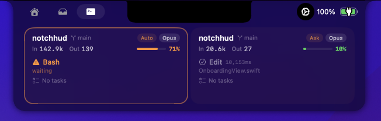

# notchHUD

A fork of [boring.notch](https://github.com/TheBoredTeam/boring.notch) that adds real-time AI coding agent monitoring to the MacBook notch.

See your Claude Code, Codex, and OpenCode sessions live — tool calls, token usage, context window, git branch, and permission requests — all without leaving your editor.

## Screenshots



## Features

**Everything in boring.notch, plus:**

- **Multi-session monitoring** — auto-discovers all active Claude Code / Codex / OpenCode sessions via `~/.claude/` file watching
- **Live tool tracking** — see active and recent tool calls (Bash, Read, Edit, Grep, etc.) with duration
- **Token & context usage** — input/output tokens and context window percentage with color-coded bar
- **Permission alerts** — notch glows orange when a session needs user approval
- **Activity glow** — subtle green glow when agents are actively working
- **Session cards** — two-up card layout showing project name, git branch, model, and permission mode
- **Paginated sessions** — swipe horizontally when more than 2 sessions are active
- **Zero config** — no OTLP setup needed, reads directly from Claude Code's local state files

## Requirements

- macOS 14 (Sonoma) or later
- Xcode 15+ (to build from source)
- MacBook with notch (works on any Mac, but designed for notch)

## Installation

### Download (Recommended)

Download the latest pre-built `notchHUD.app` from [GitHub Releases](https://github.com/LadderChaos/notchhud/releases). Unzip, drag to Applications, and run.

> **Note:** The app is not notarized. On first launch, right-click → Open (or go to System Settings → Privacy & Security → Open Anyway).

### Build from Source

1. Clone the repository:
   ```bash
   git clone https://github.com/LadderChaos/notchhud.git
   cd notchhud
   ```
2. Open in Xcode:
   ```bash
   open boringNotch.xcodeproj
   ```
3. Select your signing team in **Signing & Capabilities**.
4. Build and run (`Cmd+R`).

## Usage

Just run the app and start your AI coding sessions. notchHUD auto-detects sessions from `~/.claude/` — no configuration needed.

Click the notch to expand and see full session details. The companion shows:
- Project name and git branch
- Model (Opus, Sonnet, etc.) and permission mode (YOLO, Auto, Ask, Plan)
- Active/recent tool calls with duration
- Input/output token counts and context window usage
- Todo progress

## Architecture

The Companion feature lives in `boringNotch/Companion/` and integrates into boring.notch's existing notch UI:

```
boringNotch/Companion/
  ClaudeCodeModels.swift    — Session, state, token, and tool models
  CompanionManager.swift    — File-watching session discovery and JSONL parsing
  CompanionView.swift       — Expanded session cards (two-up, paginated)
  CompanionLiveActivity.swift — Compact collapsed view in the notch
  NotchGlowEffect.swift     — Permission and activity glow effects
```

Integration points in boring.notch (~17 lines of glue code):
- `enums/generic.swift` — added `claudeCode` view case
- `models/Constants.swift` — added settings keys
- `boringNotchApp.swift` — CompanionManager initialization
- `ContentView.swift` — companion views in closed/open states

## License

This project is a derivative of [boring.notch](https://github.com/TheBoredTeam/boring.notch) and is licensed under the [GNU General Public License v3.0](LICENSE).

The Companion feature (`boringNotch/Companion/`) was written by the maintainers of this fork.
